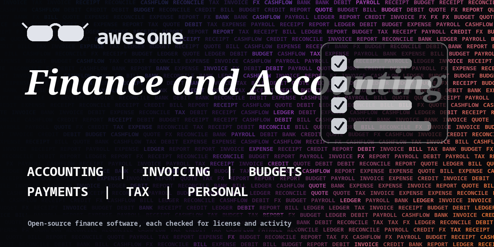

<h1 align="center">Awesome Finance and Accounting</h1>

> Open-source accounting, invoicing, budgeting, personal finance, payments and tax tools for freelancers and small businesses. Every entry shows its license.

**Rules of this list:** every repo exists, is public, is not archived, states a license and has had a commit in the last year. One plain sentence each. Star counts and claims are the authors' own, we did not test every tool. Checked 2026-10-18. See [CONTRIBUTING.md](CONTRIBUTING.md).

## Contents

- [Accounting and ERP](#accounting-and-erp)
- [Invoicing and billing](#invoicing-and-billing)
- [Personal finance and budgeting](#personal-finance-and-budgeting)
- [Plain-text accounting](#plain-text-accounting)
- [Expenses and receipts](#expenses-and-receipts)
- [Banking data and payments](#banking-data-and-payments)
- [Tax and compliance](#tax-and-compliance)
- [Investment tracking](#investment-tracking)
- [How to choose](#how-to-choose)
- [Contributing](#contributing)

## Accounting and ERP

Books, ledgers and small-business suites.

- [akaunting/akaunting](https://github.com/akaunting/akaunting)  - Free online accounting software for small businesses. _(check repo)_
- [apache/fineract](https://github.com/apache/fineract)  - Core banking and microfinance platform. _(Apache-2.0)_
- [bigcapitalhq/bigcapital](https://github.com/bigcapitalhq/bigcapital)  - Open-source accounting and inventory software. _(AGPL-3.0)_
- [frappe/erpnext](https://github.com/frappe/erpnext)  - Open-source ERP with accounting, inventory and HR. _(GPL-3.0)_
- [inventree/InvenTree](https://github.com/inventree/InvenTree)  - Open-source inventory management system. _(MIT)_
- [ledger/ledger](https://github.com/ledger/ledger)  - Command-line double-entry accounting tool. _(check repo)_
- [ledgersmb/LedgerSMB](https://github.com/ledgersmb/LedgerSMB)  - Open-source accounting and ERP for small businesses. _(check repo)_
- [odoo/odoo](https://github.com/odoo/odoo)  - Open-source business apps including accounting and invoicing. _(check repo)_

## Invoicing and billing

Send invoices and bill customers.

- [getlago/lago](https://github.com/getlago/lago)  - Open-source usage-based billing and metering. _(AGPL-3.0)_
- [invoiceninja/invoiceninja](https://github.com/invoiceninja/invoiceninja)  - Invoicing, quotes and payments for small businesses. _(check repo)_
- [InvoiceShelf/InvoiceShelf](https://github.com/InvoiceShelf/InvoiceShelf)  - Open-source invoicing app for freelancers and small businesses. _(AGPL-3.0)_
- [killbill/killbill](https://github.com/killbill/killbill)  - Open-source subscription billing and payments platform. _(Apache-2.0)_

## Personal finance and budgeting

Track money you own.

- [actualbudget/actual](https://github.com/actualbudget/actual)  - Local-first personal finance app with envelope budgeting. _(MIT)_
- [firefly-iii/firefly-iii](https://github.com/firefly-iii/firefly-iii)  - Free and open-source personal finance manager. _(AGPL-3.0)_

## Plain-text accounting

Ledger files you control.

- [beancount/beancount](https://github.com/beancount/beancount)  - Double-entry accounting from text files. _(GPL-2.0)_
- [beancount/beangulp](https://github.com/beancount/beangulp)  - Importers framework for Beancount. _(GPL-2.0)_
- [beancount/fava](https://github.com/beancount/fava)  - Web interface for Beancount. _(MIT)_
- [hledgerorg/hledger](https://github.com/hledgerorg/hledger)  - Robust, friendly plain text accounting software. _(GPL-3.0)_

## Expenses and receipts

Scan, track and share costs.

- [paperless-ngx/paperless-ngx](https://github.com/paperless-ngx/paperless-ngx)  - Document management system that scans and indexes your papers. _(GPL-3.0)_
- [spliit-app/spliit](https://github.com/spliit-app/spliit)  - Free and open-source way to split expenses with friends. _(MIT)_
- [tesseract-ocr/tesseract](https://github.com/tesseract-ocr/tesseract)  - Open-source OCR engine, useful for receipt scanning. _(Apache-2.0)_

## Banking data and payments

Connect bank data and move money.

- [btcpayserver/btcpayserver](https://github.com/btcpayserver/btcpayserver)  - Self-hosted Bitcoin payment processor with no fees. _(MIT)_
- [jsvine/pdfplumber](https://github.com/jsvine/pdfplumber)  - Extract text and tables from PDFs. _(MIT)_
- [juspay/hyperswitch](https://github.com/juspay/hyperswitch)  - Open-source payments switch that routes across processors. _(Apache-2.0)_
- [plaid/plaid-python](https://github.com/plaid/plaid-python)  - Official Python library for the Plaid API. The service behind it is paid. _(MIT)_
- [stripe/stripe-node](https://github.com/stripe/stripe-node)  - Official Stripe library for Node.js. _(MIT)_
- [stripe/stripe-python](https://github.com/stripe/stripe-python)  - Official Stripe library for Python. _(MIT)_

## Tax and compliance

Calculate and file. Check local rules.

- [openfisca/openfisca-core](https://github.com/openfisca/openfisca-core)  - Engine for tax and benefit rules as code. _(AGPL-3.0)_

## Investment tracking

Watch your portfolio.

- [ghostfolio/ghostfolio](https://github.com/ghostfolio/ghostfolio)  - Open-source wealth management software for tracking stocks, ETFs and crypto. _(AGPL-3.0)_
- [openbq-org/OpenBB](https://github.com/openbq-org/OpenBB)  - Open data platform for analysts, quants and AI agents. _(check repo)_
- [ranaroussi/yfinance](https://github.com/ranaroussi/yfinance)  - Download Yahoo Finance data in Python. For personal use, check Yahoo's terms. _(Apache-2.0)_
- [wealthfolio/wealthfolio](https://github.com/wealthfolio/wealthfolio)  - Private desktop investment tracker. _(AGPL-3.0)_
- [wealthfolio/wealthfolio](https://github.com/wealthfolio/wealthfolio)  - Private, desktop investment tracker. _(AGPL-3.0)_

## How to choose

- **Not tax or legal advice.** Check rules in your country or ask an accountant.
- **Self-hosting finance data means you do backups and security.**
- **Check the license and the data format.** You should be able to export everything.
- **Test with fake data first.**

## Contributing

See [CONTRIBUTING.md](CONTRIBUTING.md). One entry per pull request, plain words, real sources only.

## About

Maintained by [@devanasolver](https://github.com/devanasolver). Listings follow the rules in CONTRIBUTING.

## Sponsor me

If this list is useful, [buy me a coffee](https://buymeacoffee.com/isaac49).
